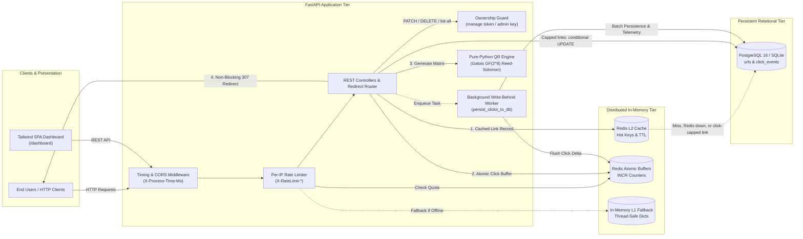

<div align="center">

# ⚡ LinkPulse: Distributed URL Shortener & Telemetry Platform

A production-style URL shortening and click-analytics service engineered with **FastAPI**, **Redis**, and **PostgreSQL**. Features cache-served redirects, write-behind click buffering, per-link ownership tokens, atomic click quotas, privacy-preserving visitor analytics, and a pure-Python Reed-Solomon QR code generator.

**Live demo:** [web-production-f4e28.up.railway.app](https://web-production-f4e28.up.railway.app) · [API docs](https://web-production-f4e28.up.railway.app/docs)

[](https://www.python.org/)
[](https://fastapi.tiangolo.com/)
[](https://www.postgresql.org/)
[](https://redis.io/)
[](https://www.docker.com/)
[](https://github.com/Adilm8/fastapi-url-shortener/actions/workflows/ci.yml)
[](LICENSE)

[Interactive Dashboard](http://localhost:8000/dashboard) • [API Swagger Docs](http://localhost:8000/docs) • [ReDoc](http://localhost:8000/redoc)

</div>

---

## 🌟 Executive Engineering Highlights

- **Low-Latency Redirect Path**: Decouples HTTP 307 temporary redirects from synchronous relational database writes: uncapped links are served entirely from the Redis cache (including expiry checks), and clicks are counted with atomic Redis `INCR` counters and persisted in a background task. Click-capped links claim each click with a single conditional SQL `UPDATE`, so concurrent requests can never exceed `max_clicks`.
- **Base62 Slicing with Salted Collision Resolution**: Generates concise 7-character aliases across a 62-character alphabet ($62^7 \approx 3.52$ trillion keys) using truncated SHA-256 digests: the first candidate is deterministic, and collisions are re-probed with random salts so codes for the same URL can never run out.
- **Granular, Privacy-Preserving Telemetry**: Logs device categories (Desktop, Mobile, Tablet, Bot), browsers, operating systems, and referring domains, while tracking unique visitors via salted SHA-256 IP hashing; raw IPs are not stored.
- **Pure-Python Reed-Solomon QR Code Engine**: Generates ISO/IEC 18004 visual matrices directly in vector SVG XML and raster PNG bytes using Galois Field $GF(2^8)$ arithmetic with no external QR-code API (Pillow is used only for PNG rendering).
- **Graceful Dual-Layer Degradation (L2 -> L1 Fallback)**: Automatically falls back to in-memory caching and sliding-window rate tracking if Redis is unreachable, and re-probes Redis every 15 seconds so the service recovers by itself when Redis returns.
- **Full Link Lifecycle Governance**: Supports custom aliases, automated time-to-live (TTL) expiration (`expires_at` / `expires_in_seconds`), click quotas (`max_clicks`), and soft deactivation/reactivation (`PATCH`).
- **Per-Link Ownership**: Each new link returns a one-time `manage_token`; only that token (or the operator's `ADMIN_API_KEY`) can modify or delete the link.
- **Spoof-Resistant Rate Limiting**: Protects the `POST` creation endpoints with Redis-backed per-IP fixed-window limits (sliding window in the in-memory fallback), emitting standard `X-RateLimit-*` and `Retry-After` HTTP headers. Client IPs are read from the trusted end of `X-Forwarded-For` only.
- **Self-Contained Dark-Mode Web Dashboard**: Responsive single-page application built with Tailwind CSS at `/dashboard`, supporting 1-click link creation, batch shortening, live analytics drawer, and QR code downloads. It remembers the links created in each browser, and an optional admin key unlocks every link.

---

## 🏛️ System Architecture



---

## 📊 Feature Matrix

| Feature | LinkPulse | Basic Implementations |
| :--- | :---: | :---: |
| **Shortcode Generation** | **Deterministic SHA-256 + Base62 ($62^7$ keys)** | Sequential Auto-Increment ID (Crawling Risk) |
| **Collision Resolution** | **Salted re-probing (random salts after the first candidate)** | Unhandled / Crash on Unique Violation |
| **Redirect Latency** | **Served from Redis cache; no synchronous DB write on the redirect path** | Synchronous DB lookup and write per redirect |
| **Click Persisting** | **Non-blocking Write-Behind (`BackgroundTasks`)** | Synchronous relational DB `UPDATE` |
| **Visitor Telemetry** | **Device, OS, Browser, Referrer, Unique Visitors** | Basic integer increment |
| **Privacy / PII Compliance** | **Salted SHA-256 IP hashing (raw IPs not stored)** | Raw IP logged / Stored |
| **QR Code Engine** | **Pure-Python Reed-Solomon encoder ($GF(2^8)$), Pillow for PNG** | External 3rd-party API (Privacy Leak) |
| **Link Governance** | **TTL Expiration, Atomic Click Quotas, Soft Toggling** | Permanent only |
| **Access Control** | **Per-link manage tokens + optional admin key** | Anyone can edit or delete any link |
| **Rate Limiting** | **Per-IP limits with `Retry-After`, resistant to forged `X-Forwarded-For`** | None |
| **Resilience Tier** | **Graceful L2 (Redis) -> L1 (In-Memory) Fallback with auto-reconnect** | Hard crash if Redis offline |
| **Web Dashboard** | **Tailwind CSS Dark-Mode SPA (`/dashboard`)** | None / Generic Swagger only |

---

## 🔌 API Reference & Endpoints

All endpoints are versioned under `/api/v1` (with standard roots for health, redirect, and dashboard).

| Method | Endpoint | Description | Response Model |
| :--- | :--- | :--- | :--- |
| `GET` | `/` | API status, version, and algorithmic metadata | JSON discovery object |
| `GET` | `/health` | System health check: database status (`healthy`/`unhealthy`), active cache backend (`redis` or `in-memory`), and version | `HealthResponse` |
| `GET` | `/api/v1/metrics` | Operational metrics (cache hit ratio, total links/clicks) | `MetricsResponse` |
| `POST` | `/api/v1/urls` | Create short URL (Base62 or Custom Alias, TTL, Max Clicks) | `URLResponse` (201) |
| `POST` | `/api/v1/urls/batch` | Batch shorten multiple URLs (up to 20 per request) | `URLBatchResponse` (201) |
| `GET` | `/api/v1/urls` | Paginated link list with search & active-status filters. Admin key lists all links; otherwise pass `?codes=a,b,c` | `URLListResponse` |
| `GET` | `/api/v1/urls/{short_code}/stats` | Granular telemetry, demographic breakdowns, & unique visitors | `URLStatsResponse` |
| `PATCH` | `/api/v1/urls/{short_code}` | Update target URL, active status, expiration, or click cap (🔒 manage token or admin key) | `URLResponse` |
| `DELETE` | `/api/v1/urls/{short_code}` | Decommission link, delete click events, and purge cache (🔒 manage token or admin key) | `204 No Content` |
| `GET` | `/api/v1/urls/{short_code}/qr` | Generate scannable QR Code matrix (`format=svg` or `png`) | `image/svg+xml` / `image/png` |
| `GET` / `HEAD` | `/{short_code}` | Temporary redirect with background click telemetry (`410` if expired, inactive, or over quota). `HEAD` resolves without counting a click | `307 Temporary Redirect` |

### Authentication

Creating a link returns a `manage_token` **once**; store it. Send it to manage that link:

```bash
curl -X PATCH "http://localhost:8000/api/v1/urls/fastapi-docs" \
     -H "Authorization: Bearer <manage_token>" \
     -H "Content-Type: application/json" \
     -d '{"is_active": false}'
```

Missing credentials return `401`; a token for a different link returns `403`. Setting the `ADMIN_API_KEY` environment variable enables an operator key (sent the same way, or as `X-API-Key`) that can list all links and manage any link. Links created before tokens existed can only be managed with the admin key. Stats, QR codes, and metrics stay public.

The dashboard keeps the tokens of links it creates in the browser's local storage and lists those links; enter the admin key in the dashboard to see and manage every link.

### Configuration

| Variable | Default | Purpose |
| :--- | :--- | :--- |
| `DATABASE_URL` | `sqlite:///./url_shortener.db` | SQLAlchemy URL (`postgres://` URLs are normalized) |
| `REDIS_URL` | `redis://localhost:6379/0` | Redis server; the app falls back to in-memory and reconnects automatically |
| `ADMIN_API_KEY` | *(empty: disabled)* | Operator key for listing and managing all links |
| `IP_HASH_SALT` | `url_shortener_ip_salt` | Secret salt for visitor IP hashes; set a private value in production |
| `TRUSTED_PROXY_HOPS` | `1` | Reverse proxies that append to `X-Forwarded-For` (Railway: `1`; direct access: `0`) |
| `BASE_URL` | `http://localhost:8000` | Public URL, also blocked as a shortening target to prevent redirect loops |
| `RATE_LIMIT_REQUESTS` / `RATE_LIMIT_WINDOW_SECONDS` | `10` / `60` | Creation rate limit per client IP |

### Validation & limits

- `custom_code`: 3-16 characters, `[A-Za-z0-9_-]` only; reserved system keywords are rejected with `400`.
- Every create returns a new, independently owned link, even for a long URL that was shortened before.
- `long_url` must be `http`/`https` and at most 2048 characters. All timestamps are UTC and returned with a `Z` suffix; expiry times sent with a UTC offset are converted.
- A redirect to an expired, deactivated, or over-quota (`max_clicks`) link returns `410 Gone`.
- Batch requests accept 1-20 URLs.
- Rate limiting applies only to the `POST` creation endpoints (single and batch), default 10 requests per 60 seconds per client IP and path; responses carry `X-RateLimit-*` headers and `429` responses include `Retry-After`. Redirects are not rate limited. The client IP is taken from `X-Forwarded-For` only as far back as `TRUSTED_PROXY_HOPS` allows, so clients cannot dodge the limit by forging the header.

---

## 💻 CLI & `curl` Examples

### 1. Create a Shortened URL with Custom Alias, Expiration, and Max Clicks
```bash
curl -X POST "http://localhost:8000/api/v1/urls" \
     -H "Content-Type: application/json" \
     -d '{
       "long_url": "https://fastapi.tiangolo.com/tutorial/",
       "custom_code": "fastapi-docs",
       "expires_in_seconds": 86400,
       "max_clicks": 500
     }'
```

**Response (`201 Created`):**
```json
{
  "short_code": "fastapi-docs",
  "short_url": "http://localhost:8000/fastapi-docs",
  "long_url": "https://fastapi.tiangolo.com/tutorial/",
  "created_at": "2026-10-24T21:00:00Z",
  "expires_at": "2026-10-25T21:00:00Z",
  "is_active": true,
  "max_clicks": 500,
  "click_count": 0,
  "qr_code_url": "http://localhost:8000/api/v1/urls/fastapi-docs/qr",
  "manage_token": "Wq3...store-this-secret..."
}
```

### 2. Batch Shorten Multiple Links
```bash
curl -X POST "http://localhost:8000/api/v1/urls/batch" \
     -H "Content-Type: application/json" \
     -d '{
       "urls": [
         {"long_url": "https://github.com"},
         {"long_url": "https://redis.io"},
         {"long_url": "https://www.postgresql.org"}
       ]
     }'
```

### 3. Test Redirect & Timing Header
```bash
curl -I "http://localhost:8000/fastapi-docs"
```

**Headers (illustrative values; `x-process-time-ms` varies per request):**
```http
HTTP/1.1 307 Temporary Redirect
location: https://fastapi.tiangolo.com/tutorial/
x-process-time-ms: 0.78
```

### 4. Fetch Rich Visitor Analytics
```bash
curl "http://localhost:8000/api/v1/urls/fastapi-docs/stats"
```

**Response:**
```json
{
  "short_code": "fastapi-docs",
  "short_url": "http://localhost:8000/fastapi-docs",
  "long_url": "https://fastapi.tiangolo.com/tutorial/",
  "click_count": 42,
  "created_at": "2026-10-24T21:00:00Z",
  "is_active": true,
  "is_expired": false,
  "unique_visitors": 29,
  "clicks_by_date": { "2026-10-24": 42 },
  "top_referrers": { "google.com": 18, "Direct": 14, "t.co": 10 },
  "device_breakdown": { "Desktop": 28, "Mobile": 14 },
  "browser_breakdown": { "Chrome": 24, "Safari": 12, "Firefox": 6 },
  "os_breakdown": { "macOS": 20, "Windows": 14, "iOS": 8 }
}
```

### 5. Download Standalone QR Code (Vector SVG or Raster PNG)
```bash
# Save vector SVG directly:
curl "http://localhost:8000/api/v1/urls/fastapi-docs/qr?format=svg" -o qrcode.svg

# Save raster PNG:
curl "http://localhost:8000/api/v1/urls/fastapi-docs/qr?format=png&scale=10" -o qrcode.png
```

---

## 🚀 Quickstart Guide

### Option A: 1-Command Docker Compose (Full Stack)

Run the full distributed stack (**FastAPI + PostgreSQL 16 + Redis 7**) with zero local configuration:

```bash
docker compose up --build
```

Set `ADMIN_API_KEY` in your shell or `.env` to enable the admin key. Compose sets `TRUSTED_PROXY_HOPS=0` because nothing sits in front of the app; if you put a reverse proxy in front, set it to the number of proxies.

- **Web Dashboard**: [http://localhost:8000/dashboard](http://localhost:8000/dashboard)
- **Interactive OpenAPI Docs**: [http://localhost:8000/docs](http://localhost:8000/docs)
- **Alternative ReDoc UI**: [http://localhost:8000/redoc](http://localhost:8000/redoc)

---

### Option B: Local Python Development (SQLite, no external services)

LinkPulse runs out-of-the-box using local SQLite and automatic in-memory caching/rate-limiting if PostgreSQL and Redis are not running:

1. **Clone and enter repository:**
   ```bash
   git clone https://github.com/Adilm8/fastapi-url-shortener.git
   cd fastapi-url-shortener
   ```

2. **Create and activate a virtual environment:**
   ```bash
   python -m venv venv
   # Windows:
   .\venv\Scripts\activate
   # macOS/Linux:
   source venv/bin/activate
   ```

3. **Install dependencies:**
   ```bash
   pip install --upgrade pip
   pip install -r requirements.txt
   ```

4. **(Optional) Create a local environment file:**
   ```bash
   cp .env.example .env
   ```

5. **Start the ASGI server:**
   ```bash
   uvicorn app.main:app --reload
   ```
   Without a reverse proxy in front, set `TRUSTED_PROXY_HOPS=0` (in `.env`) so clients cannot pick their own IP for rate limiting.

---

## ☁️ Deployment (Railway)

The live demo runs on [Railway](https://railway.com) with managed PostgreSQL and Redis. The `web` service builds from the [`Dockerfile`](Dockerfile) and **deploys automatically on every push to `main`**.

Service variables:

| Variable | Value |
| :--- | :--- |
| `DATABASE_URL` / `REDIS_URL` | References to the Railway Postgres and Redis services |
| `ADMIN_API_KEY` | Long random secret (operator access) |
| `IP_HASH_SALT` | Long random secret |
| `TRUSTED_PROXY_HOPS` | Leave at the default `1` (Railway's edge proxy) |

On startup the app creates missing tables and adds columns introduced by newer versions (e.g. `urls.manage_token_hash`), so upgrades need no manual migration. Links created before ownership tokens existed can be managed with the admin key.

---

## 🧪 Automated Testing & CI

The `pytest` suite (run against an in-memory SQLite database) covers Base62 encoding and salted collision resolution, link creation and custom/reserved codes, redirects and click analytics, the Redis cache path, rate limiting, TTL expiry and click quotas, PATCH/DELETE lifecycle, pagination and search, batch creation, health and metrics endpoints, and QR code generation. A dedicated hardening suite ([`tests/test_hardening.py`](tests/test_hardening.py)) covers ownership tokens and admin access, listing restrictions, forged `X-Forwarded-For` headers, UTC timestamp handling, atomic click quotas, `HEAD` redirects, cache-only redirects, Redis reconnection, oversized QR payloads, and the startup schema migration.

Run the test suite locally with `pytest`:

```bash
pip install -r requirements-dev.txt
python -m pytest -v
```

### GitHub Actions CI Matrix

Every `push` and `pull_request` to `main` or `master` executes an automated GitHub Actions pipeline ([`.github/workflows/ci.yml`](.github/workflows/ci.yml)) testing across:
- **Python 3.11**
- **Python 3.12**
- **Python 3.13**

CI runs the tests against SQLite; PostgreSQL is used by the Docker Compose stack but is not exercised in CI.

---

## 📄 License

This project is licensed under the terms of the **MIT License**.
